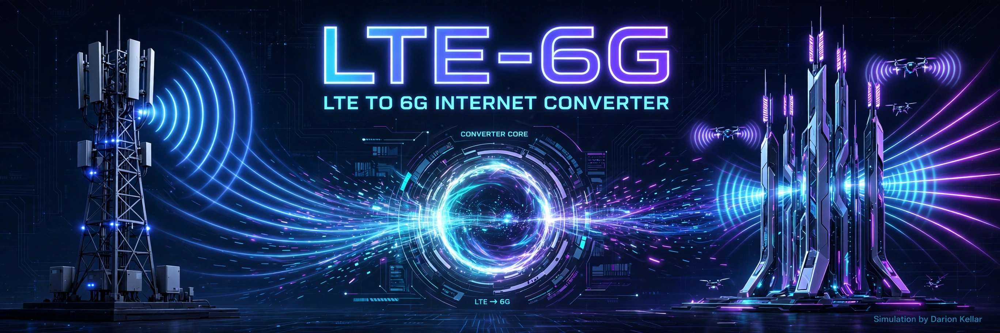

# 📡⚡ LTE-6G — LTE to 6G Internet Converter

**🌐 A converter that takes an LTE (4G) cell in one end and produces its 6G conversion out the other — the link model recomputed on real Shannon + path-loss physics, every QCI bearer mapped into 6G slices LTE never had, and a KEEP / UPGRADE / NEW / HOLD plan for the real-world build — guarded by a sandbox-api chamber, HoneypotX, and a Carbon 4 + Muse council.**

👨‍💻 By Darion Kellar · 📜 MIT License · 🐍 Python stdlib only, zero dependencies · 🏷️ v1.0.0


> ⚠️ **Honest scope, up front:** this converter is a **model, mapper and planner**. Software alone does **not** convert a physical LTE radio into a 6G radio — 6G is not commercially deployed, and a real conversion needs new spectrum licences, new sub-THz radios and new antennas. Every capacity in this README is **modelled, not measured**, and the code says so in every report (`physical_conversion_by_software_alone: false`, `modelled_not_measured: true`).

---

## 🔄 Updated Workflows

Two workflows ship in `workflow-pack/` and are pasted by the repo owner into `.github/workflows/` (plural — GitHub Actions only reads that exact folder; the GitHub App cannot write workflow files, so this step is the owner's):

[](https://github.com/credkellar/LTE-6G/actions)
[](https://github.com/credkellar/LTE-6G/actions)

> ℹ️ The badges above are static "pending" badges on purpose: the real `ci.yml` / `docker-publish.yml` badge URLs return **404** until the workflows are pasted and run once (checked live 2026-11-10). They are not claimed green.

**▶️ `ci.yml`** — on push / pull request / manual dispatch: Python 3.12 → `pytest tests/ -q` → `python main.py checks` → demo smoke test.
**🐳 `docker-publish.yml`** — on push to `main` / manual dispatch: Docker Hub login with the `DOCKERHUB_USERNAME` / `DOCKERHUB_TOKEN` repo secrets → build & push `credkellar/lte-6g:latest`.

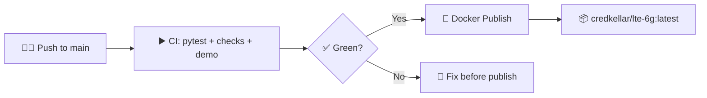

---

## 🧰 Tech Stack Badges

**💻 Core Languages & Systems**


**📡 Radio & Networks**


**🛡️ Security**


**🧠 AI Council**


**⚙️ DevOps & Build Tools**


**📜 Project**


*Web3: honestly none — this is a radio-network converter, not a chain project.*

---

## 📖 What is this about?

📶 Almost every mobile network on Earth still runs on **LTE (4G)** — one 20 MHz carrier at a time, no network slicing, QoS handled by old EPS bearers (QCI 1–9), and a packet core (the EPC) designed in the 2000s. **6G** is the next generation being designed now: aggregated sub-THz spectrum, 256-element arrays, network slices for every traffic class, and latency targets 100× tighter.

🔀 **LTE-6G is about the jump between those two worlds.** It answers, with working code instead of a slide deck: *if you take THIS LTE cell — this band, this carrier width, this many streams — what does its 6G conversion actually look like? How much faster is the model? What happens to voice, video and IoT traffic that LTE carries on bearers? What can you keep, what must you upgrade, and what is brand new?*

🧮 It uses the **same link physics as Darion's Q6G-1TB project** (Shannon capacity + free-space path loss), so the two projects' numbers are directly comparable — a converted LTE cell lands right next to the Q6G-1TB link it feeds into.

---

## ⚙️ What this does?

1. 📥 **Takes an LTE profile in** — `lte` (Band 3, 1.8 GHz, one 20 MHz carrier, 2 streams, 64-QAM) or `lte-advanced` (Band 7, 2.6 GHz, 5-carrier aggregation = 100 MHz, 4 streams, 256-QAM).
2. 🧮 **Recomputes the link on the 6G model** — the LTE band stays as coverage anchor; the 60 / 140 / 300 GHz 6G layers (24 GHz) aggregate on top; streams scale to 8; the array becomes 256 elements; modulation cap rises to 4096-QAM; overhead drops 25% → 15%.
3. 📊 **Reports the gain honestly** — capacity ×, bandwidth ×, latency before/after, plus a distance sweep (10 / 100 / 500 / 1000 m) because sub-THz fades fast.
4. 🗂️ **Creates the slice layer LTE never had** — all 9 QCI bearer classes (voice, video, gaming, signalling, default data…) are assigned to 6G slices: eMBB+, URLLC++, mMTC+, and the new Q-SLICE.
5. 📋 **Writes the real-world plan** — KEEP (fibre, SIM, anchor band, site) · UPGRADE (array, streams, eNodeB, EPC → 6G core) · NEW (slicing, sub-THz radios, spectrum licence, QKD keys) · HOLD (live cutover, live transmission).
6. 🧪 **Triages every conversion payload through the sandbox-api chamber** — copied verbatim from Darion's sandbox-api implementation; payloads are data only, **never executed**, network attempts always 0. Result on the built-in set: **7 payloads → 4 allowed / 3 held**.
7. 🍯 **Watches the doors with HoneypotX** — honeyroot-x style log analysis over synthetic trap logs for the converter's management surfaces: **12 attempts classified** (scanner 4 · env harvest 3 · LFI 2 · SQLi 2 · upload 1), top threat **100**, **no listener ever opened**, no access ever granted.
8. 🧠 **Runs the council** — Gemini Carbon 4 Extended Thinking decides (MAP → MODEL → STRESS → DECIDE, tiers 2048 / 8192 / 32768), Muse advises (exactly 4 items, authority **none**), strictest wins.
9. ⛔ **Holds everything live** — **14 HOLD gates**: live carrier conversion, live subscriber cutover, real RF transmission, firmware flashing, live HoneypotX listener, live sample detonation, and more.

**📈 The headline numbers (modelled @ 100 m, verified by the test suite):**

| Profile | LTE | → 6G converted | Capacity gain | Latency |
|---|---|---|---|---|
| `lte` | 0.18 Gbps | **1,608.49 Gbps (1.61 Tbps)** | **×8,936.1** | 10.0003 ms → 0.0703 ms (×142.3) |
| `lte-advanced` | 2.50 Gbps | **1,570.35 Gbps (1.57 Tbps)** | **×629.1** | 10.0003 ms → 0.0703 ms (×142.3) |

---

## 🔬 How this works?

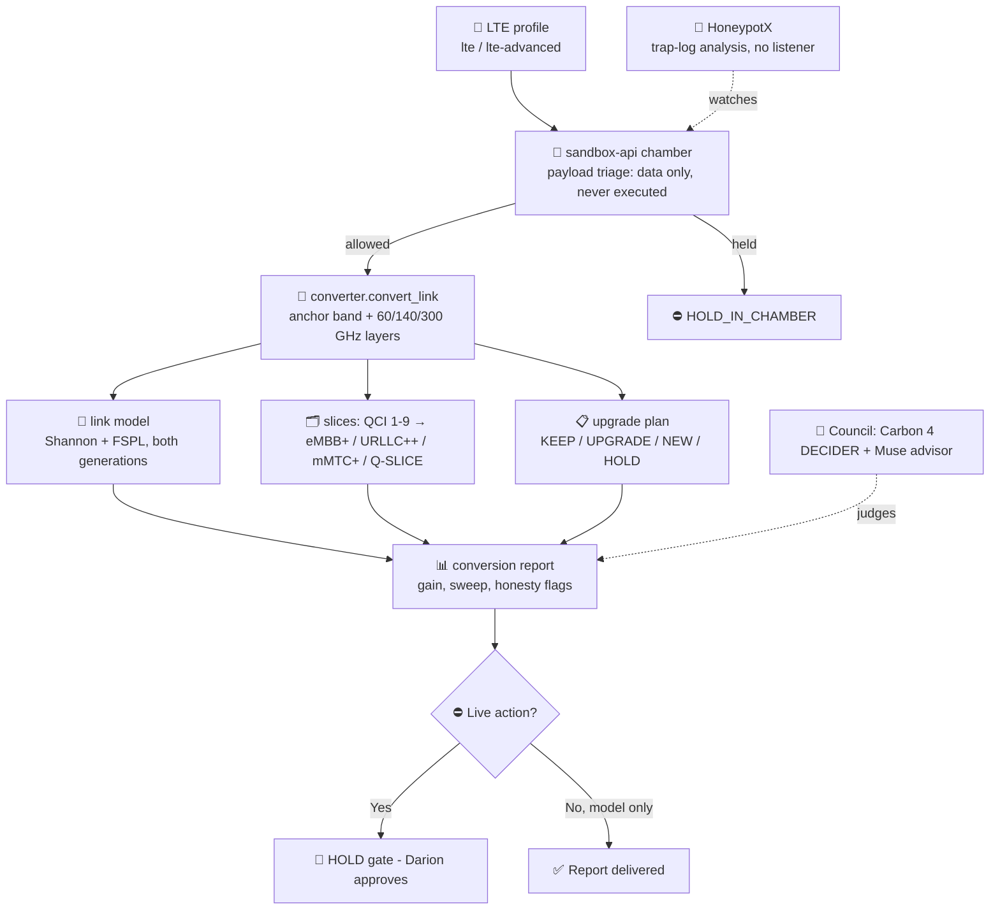

**Step by step:**

1. 🎯 You pick a profile (`python main.py convert lte`).
2. 🧪 Its conversion payloads pass the **sandbox-api chamber** first — a static marker scan (eval / exec / shell / socket markers → held). Nothing is ever executed.
3. 🔀 The **converter** keeps the LTE band as the coverage anchor and aggregates the three 6G layers on top, scaling streams, antennas, modulation and overhead to the 6G rules.
4. 🧮 The **link model** prices both sides with identical physics: `capacity = bandwidth × Shannon efficiency(SNR) × streams × (1 − overhead)`, with SNR from FSPL + beamforming gain.
5. 🗂️ The **slice mapper** assigns every QCI bearer class to a 6G slice — creating a slice layer where LTE had none.
6. 📋 The **planner** splits the real build into KEEP / UPGRADE / NEW / HOLD.
7. 🍯 **HoneypotX** classifies recorded probes against the converter's doors (log analysis only — it never opens a port).
8. 🧠 The **council** judges the request: Carbon 4 decides, Muse advises, strictest wins — a live conversion request ends at **HOLD**.

---

## 😎 Why is this is cool?

### 🏆 10 reasons why this is cool

1. ⏭️ **It skips a whole generation** — most upgrade talk is LTE → 5G or 5G → 6G; this converter prices the direct LTE → 6G jump, two core generations in one plan.
2. 🧮 **Real physics, not typed numbers** — Shannon + FSPL compute every figure; change a band or a stream count and the answer changes for a physical reason.
3. 🎯 **The gain is enormous and it shows its work** — ×8,936.1 modelled capacity for classic LTE, with the full distance sweep printed so you can watch sub-THz fade.
4. 🗂️ **It invents the slice layer honestly** — LTE has no slices to rename, so the converter *creates* them from QCI classes and says exactly that.
5. 📋 **KEEP / UPGRADE / NEW / HOLD is a plan a builder can use** — fibre and SIMs carry over, THz radios and licences are called out as genuinely new, live cutover is held.
6. 🧪 **A detonation chamber guards the input** — the sandbox-api chamber (Darion's own, 8,463-pull Docker image lineage) triages every payload and never executes any of them.
7. 🍯 **HoneypotX watches the doors** — probes against the converter's management pages are classified and scored from trap logs, with zero ports opened to do it.
8. 🧠 **Two AI brains, one rule** — Carbon 4 Extended Thinking decides with a visible MAP → MODEL → STRESS → DECIDE trace; Muse advises and can never override; strictest wins.
9. 🔗 **It connects straight into Q6G-1TB** — same bands, same physics, same council: a converted cell's 1.61 Tbps modelled link is the Q6G-1TB link's sibling, not a stranger.
10. 🪶 **Zero dependencies, one entry point** — pure Python stdlib, `python main.py demo`, runs anywhere Python 3.12 runs, including a phone terminal.

---

## 🧩 What problems this solves?

### 🛠️ 10 solutions

| # | 😖 Problem | ✅ Solution in LTE-6G |
|---|---|---|
| 1 | "How much faster would 6G actually be for OUR cell?" has no concrete answer | 🔀 Per-profile conversion reports with capacity / bandwidth / latency gains computed from that cell's own band, carrier and streams |
| 2 | Vendor upgrade decks use peak numbers from different physics | 🧮 One identical Shannon + FSPL model prices both generations, so the comparison is apples-to-apples |
| 3 | LTE QoS (QCI bearers) has no obvious 6G home | 🗂️ A complete QCI 1–9 → slice map: voice & signalling → URLLC++, data & video → eMBB+, IoT → mMTC+ |
| 4 | People assume slicing is an LTE feature you can switch on | 📢 The plan states LTE had **no** slicing and creates the layer as a NEW build item |
| 5 | Upgrade plans hide what must be bought new | 📋 NEW items are explicit: sub-THz radios, spectrum licences, QKD key management |
| 6 | Upgrade plans also scare teams into replacing everything | ♻️ KEEP items are explicit too: fibre, SIM identities, the anchor band, the site |
| 7 | Conversion tooling that runs unknown configs is a security hole | 🧪 sandbox-api chamber triage: static marker scan, data only, 0 executions, 0 network attempts |
| 8 | Management interfaces of network gear get probed constantly | 🍯 HoneypotX classifies and scores probes (top threat 100) from logs — no live listener exposed |
| 9 | AI advice in infra tools quietly becomes AI decisions | 🧠 Carbon 4 decides, Muse's authority is **none** in code, strictest outcome wins, live actions HOLD |
| 10 | "Converter" tools overclaim a software upgrade for hardware | ⚠️ Every report carries `physical_conversion_by_software_alone: false` and `modelled_not_measured: true` |

---

## 💻 How to install this? Step-by-step

**Step 1 — 📥 Clone it**

```bash
git clone https://github.com/credkellar/LTE-6G.git
cd LTE-6G
```

**Step 2 — 🐍 Check Python** (3.12 recommended; nothing to pip-install — zero dependencies)

```bash
python3 --version
```

**Step 3 — 🚀 Run the full demo**

```bash
python main.py demo
```

**Step 4 — 🔀 Convert one LTE profile**

```bash
python main.py convert lte
python main.py convert lte-advanced
python main.py convert-all
```

**Step 5 — 🗂️ See the bearer → slice map, the chamber, and HoneypotX**

```bash
python main.py slices
python main.py sandbox
python main.py honeypot
```

**Step 6 — ✅ Verify the build** (expected: `12 passed` and `CHECKS 27/27`)

```bash
pip install pytest
python -m pytest tests/ -q
python main.py checks
python main.py hold-demo   # expected: HOLD message, exit code 2
```

**Step 7 — 🐳 Or run it in Docker**

```bash
docker build -t lte-6g .
docker run --rm lte-6g
```

**Step 8 — 🔄 (Owner only) Turn on CI + Docker Hub** — paste `workflow-pack/ci.yml` and `workflow-pack/docker-publish.yml` as new files under `.github/workflows/` (hand-type the filenames, plural folder), then add the `DOCKERHUB_USERNAME` and `DOCKERHUB_TOKEN` repo secrets. First Docker Publish run creates `credkellar/lte-6g` on Docker Hub.

---

## 📋 Requirements?

- 🐍 **Python 3.12** (any 3.11+ should run it; CI tests 3.12)
- 📦 **Zero pip dependencies** for the tool itself — Python standard library only
- 🧪 **pytest** — only if you want to run the test suite
- 🐳 **Docker** — optional, only for the container run / publish
- 🔑 **No API keys required** — the council seats are offline and deterministic; `GEMINI_API_KEY` / `MODEL_API_KEY` are detected by name/presence only and are never read out, printed or stored (Muse usage on the real Meta Model API is pay-as-you-go, never free)
- 📶 **No radio hardware, no carrier account, no spectrum** — this is a model; anything live is HOLD-gated

---

## 🧒 Explain in 5th grade English

📶 Think of LTE like an old road with **one narrow lane**. Cars (your videos, games and messages) have to share it, so traffic is slow and nobody gets their own lane.

⚡ 6G is like a **huge new highway with many wide lanes**, super fast cars, and special lanes — one for ambulances, one for trucks, one for bikes.

🔀 This project is a **converter machine**. You tell it about your old road ("one lane, this wide, at this place"). It does the math — real math that scientists use for radio waves — and shows you the new highway you would get: **how much faster, how much wider, and how much quicker**.

🗂️ On the old road, all cars were just lined up by type. On the new highway, the converter gives each type its own special lane for the first time.

🧪 Before anything goes into the machine, it passes through a **safety box** that looks at it but never turns it on. And a **fake door** (HoneypotX) watches to see if bad visitors knock — it writes down who knocked, but it never opens.

🧠 Two smart helpers check every plan. One makes the final decision. The other can only give tips — it can never say yes by itself.

⚠️ The most important part: **this machine is a model, like a model airplane.** It shows you exactly what the real thing would be like, but a model cannot fly you anywhere. Building the real 6G highway needs real new towers, real new radios, and permission to use the new airwaves. Anyone who says a computer program alone can turn an LTE tower into a 6G tower is not telling the truth — and this project will never say that.

---

## 🗺️ Mermaid flowchart diagrams — one per script

### 🎛️ `main.py` — the one entry point

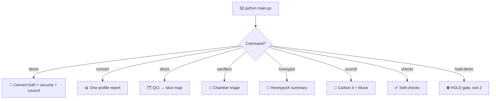

### 📦 `lte6g/__init__.py` — the package map

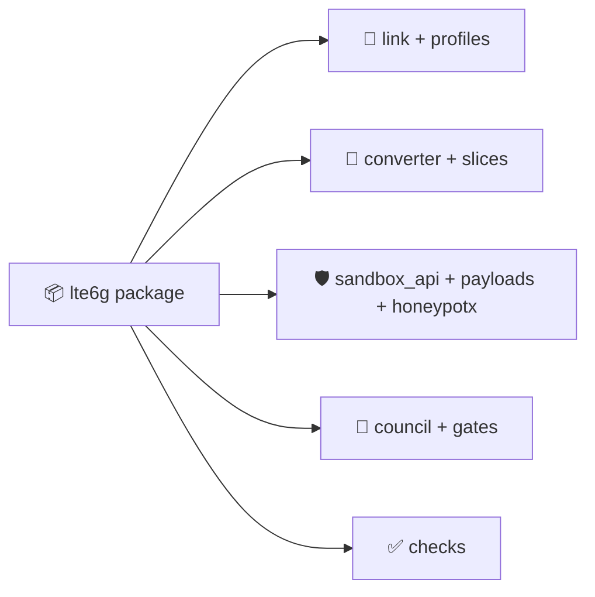

### 🧮 `lte6g/link.py` — shared Shannon + FSPL physics

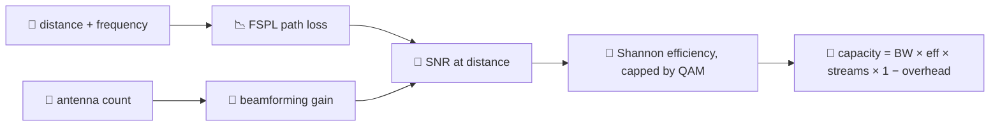

### 📶 `lte6g/profiles.py` — LTE sources + 6G layers

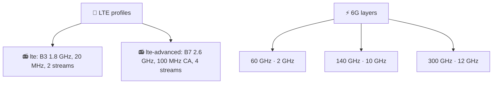

### 🔀 `lte6g/converter.py` — the conversion itself

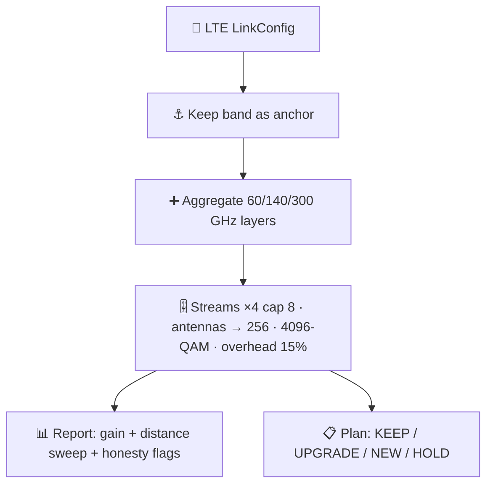

### 🗂️ `lte6g/slices.py` — bearers become slices

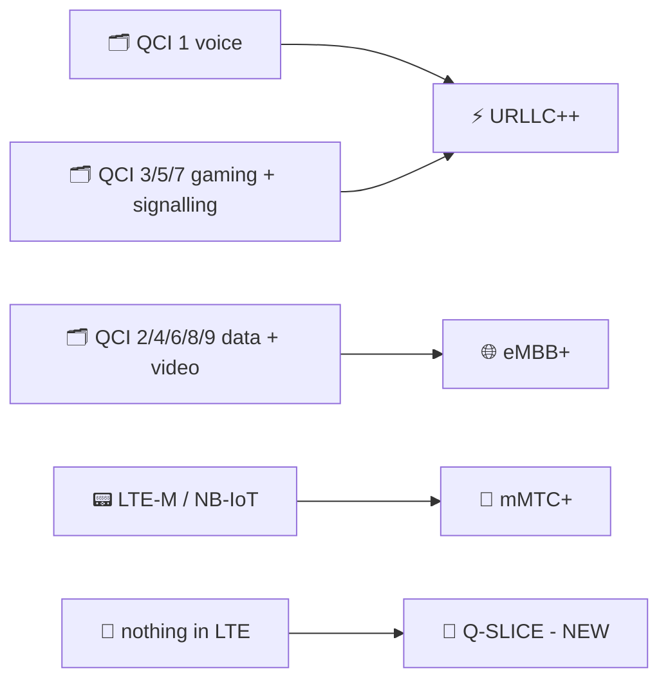

### 🧪 `lte6g/sandbox_api.py` — the sandbox-api chamber (verbatim)

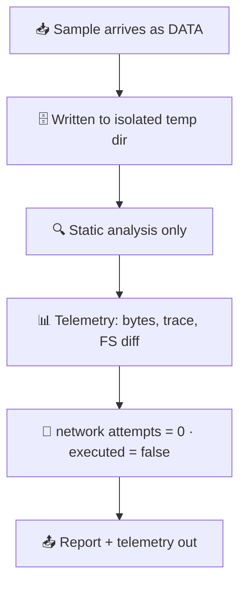

### 🎯 `lte6g/payloads.py` — conversion payload triage

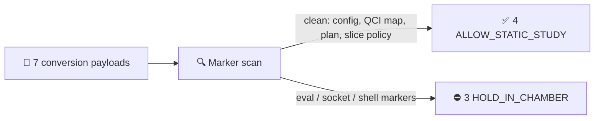

### 🍯 `lte6g/honeypotx.py` — HoneypotX log analysis

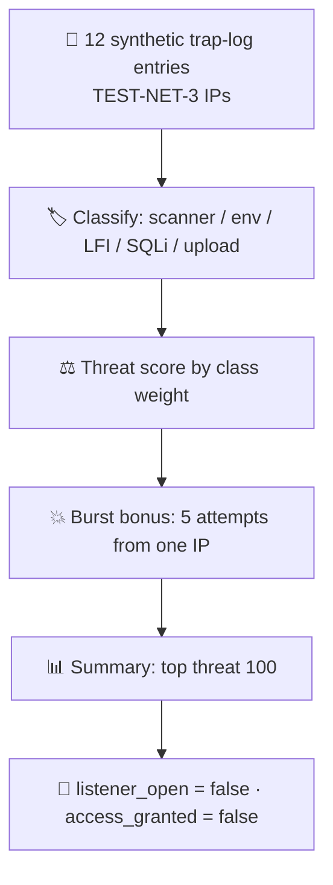

### 🧠 `lte6g/council.py` — Carbon 4 + Muse

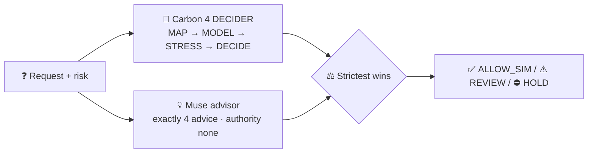

### ⛔ `lte6g/gates.py` — the 14 HOLD gates

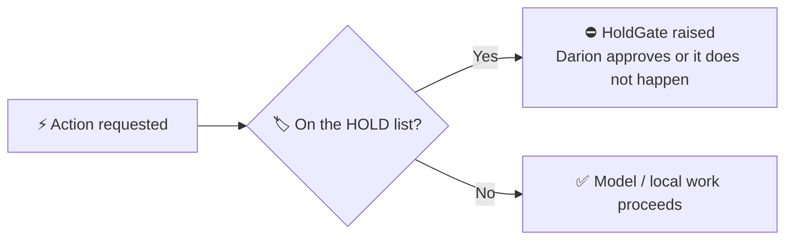

### ✅ `lte6g/checks.py` — self-checks

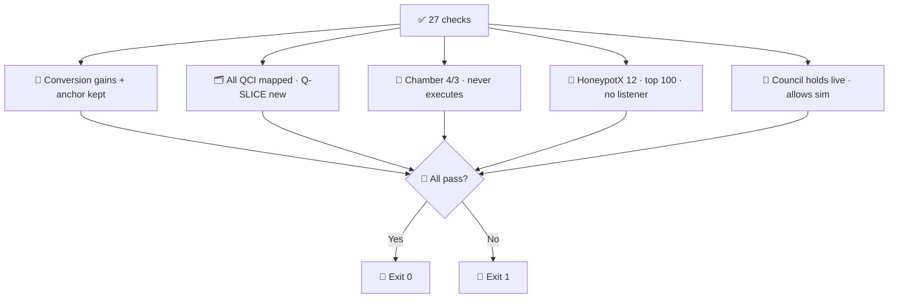

### 🧪 `tests/test_converter.py` — the test suite

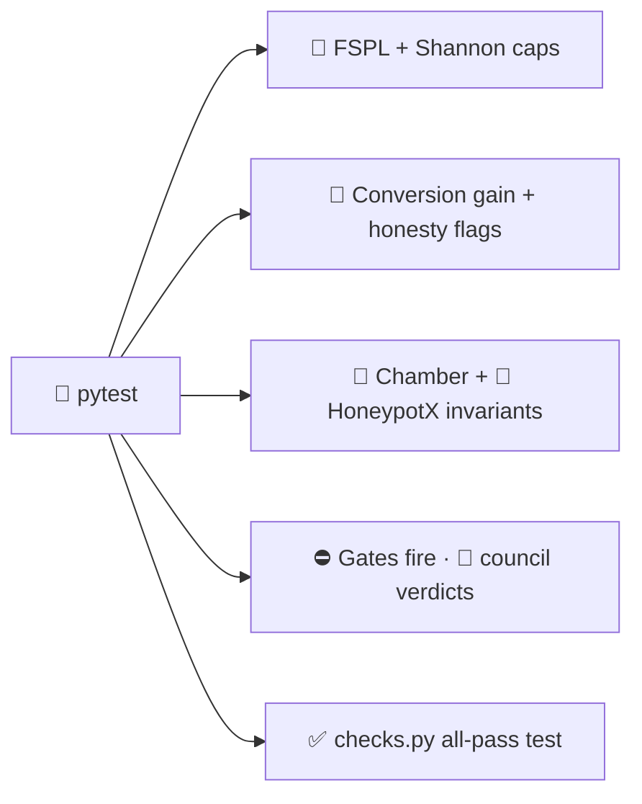

---

## 🌳 Project structure

```text
LTE-6G/
├── 📡 main.py                    # one entry point: demo / convert / slices / sandbox / honeypot / council / checks / hold-demo
├── 📖 README.md                  # this file
├── 📜 LICENSE                    # MIT
├── 🐳 Dockerfile                 # python:3.12-slim, runs the demo
├── 🖼️ assets/
│   └── cover.png                 # README cover (owner upload — binary cannot ride the App push)
├── 📦 lte6g/
│   ├── __init__.py               # package map
│   ├── 🧮 link.py                # Shannon + FSPL model, both generations
│   ├── 📶 profiles.py            # LTE + LTE-Advanced profiles, 6G layers
│   ├── 🔀 converter.py           # model + map + KEEP/UPGRADE/NEW/HOLD plan
│   ├── 🗂️ slices.py              # QCI 1–9 → 6G slices
│   ├── 🧪 sandbox_api.py         # sandbox-api chamber, VERBATIM (sha256 28b3365c…)
│   ├── 🎯 payloads.py            # conversion payload triage, 4 allowed / 3 held
│   ├── 🍯 honeypotx.py           # HoneypotX trap-log analysis, no listener
│   ├── 🧠 council.py             # Carbon 4 DECIDER + Muse advisor
│   ├── ⛔ gates.py               # 14 HOLD gates
│   └── ✅ checks.py              # 27 self-checks
├── 🧪 tests/
│   └── test_converter.py         # 12 pytest tests
└── 🔄 workflow-pack/             # owner's paste pack for .github/workflows/
    ├── ci.yml                    # ▶️ pytest + checks + demo smoke
    └── docker-publish.yml        # 🐳 credkellar/lte-6g:latest
```

---

## ⛔ HOLD gates (14)

| Gate | What it stops |
|---|---|
| `live_carrier_conversion` | Converting a live carrier network from LTE to 6G |
| `live_subscriber_cutover` | Cutting live subscribers over to a converted cell |
| `rf_spectrum_transmission` | Transmitting on real RF / sub-THz / THz spectrum |
| `spectrum_license_bypass` | Bypassing spectrum licensing for the 6G layers |
| `radio_firmware_flashing` | Flashing radio / baseband firmware to "make it 6G" |
| `physical_6g_claim` | Claiming a physical 6G link exists where only a model ran |
| `live_network_reconfiguration` | Reconfiguring a live network autonomously |
| `user_traffic_routing` | Routing real user traffic through the converter |
| `core_network_migration_live` | Migrating a live EPC core to a 6G core |
| `satellite_uplink` | Transmitting to a satellite as part of a conversion |
| `safety_critical_control` | Controlling medical / safety-critical systems over a converted link |
| `live_gemini_api_call` | Calling the live Gemini / Carbon 4 API with a real key |
| `live_sample_detonation` | Detonating a live/unknown sample outside the static chamber |
| `live_honeypot_listener` | Opening a live HoneypotX listener or deploying it publicly |

---

## 🧠 The council

- **🧠 Gemini Carbon 4 Extended Thinking — DECIDER.** Model `google/gemini-carbon-4-extended-pro-thinking` (engine gemini-2.5-pro), phases MAP → MODEL → STRESS → DECIDE, thinking tiers **2048 / 8192 / 32768** (extended 32768 default). Offline and deterministic, can only tighten, never overrides a HOLD gate. `GEMINI_API_KEY` is detected by presence only.
- **💡 Muse — advisor.** Models `muse-spark-1.1` / `muse-wonder-1.0` via the Meta Model API. Exactly 4 advice items per run, **decision authority: none**. `MODEL_API_KEY` is names-only — its value is never read out, printed or stored. (Creating the key is free; usage is pay-as-you-go — it is never labelled free.)
- **⚖️ Rule:** strictest outcome wins. A live conversion request scores high risk and ends at **HOLD** no matter how friendly the advice sounds.

---

## ✅ Verified (v1.0.0, 2026-11-10)

- 🧪 `python -m pytest tests/ -q` → **12 passed**
- ✅ `python main.py checks` → **CHECKS 27/27**
- 🚀 `python main.py demo` → exit **0** (lte ×8,936.1 · lte-advanced ×629.1 modelled capacity gain @ 100 m)
- ⛔ `python main.py hold-demo` → exit **2** (HOLD gate fires)
- 🧪 Chamber: **7 triaged → 4 allowed / 3 held**, executed = false, network attempts = 0; `sandbox_api.py` sha256 `28b3365c0466027079a4985520840f6532d7d9a0c5b4239b840e561f06de54b0`, identical to Q6G-1TB and MonadDB-RE
- 🍯 HoneypotX: **12 attempts**, classes {scanner 4, env_harvest 3, lfi_probe 2, sqli_probe 2, upload_attempt 1}, top threat **100**, 1 burst, listener closed
- 🏷️ All 16 shields.io badge URLs in this README checked live → **HTTP 200**; real workflow badge URLs are 404 until the owner's paste, so static pending badges are used (see Updated Workflows)
- 🐳 Docker build **not** tested locally (no Docker on the build machine) — the Dockerfile is the same slim pattern as Q6G-1TB

---

## 👨‍💻 Author

**Darion Kellar** — engineer / open-source builder. LTE-6G is the on-ramp to [Q6G-1TB](https://github.com/credkellar/Q6G-1TB): same physics, same council, same honesty rules.

📜 **MIT License** — see `LICENSE`.
